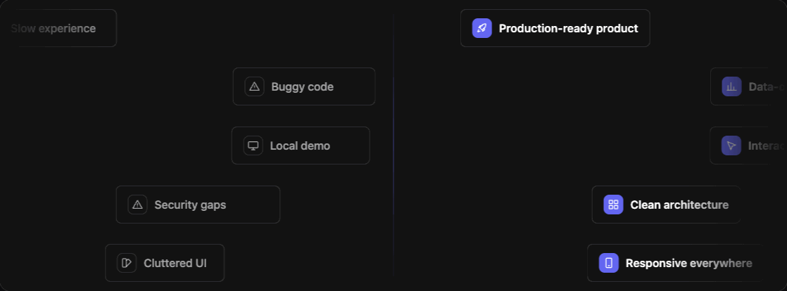

# transform-marquee



A React marquee where every chip **wipes from a "before" state into an "after" state** as it crosses a line. Rows of chips drift across the screen; at the split line, *Rough idea* becomes *Production-ready product*.

**[Live demo →](https://transform-marquee.vercel.app/)**

- **One component, a few props:** rows, chips per row, speed, direction and split position
- **Restyle with CSS variables:** border radius, colours, icon size, padding
- **Fast:** layout is measured once with `ResizeObserver`, each frame only writes `transform` and `clip-path`, and the animation stops when the marquee is off-screen
- **Accessible:** respects `prefers-reduced-motion`, has an optional pause button, and hides the animation from screen readers while giving them a plain list of the pairs
- **No dependencies** besides React 18+. Works with Next.js App Router (ships as a client component).

## Install

```bash
npm i transform-marquee
```

## Usage

```tsx
import { TransformMarquee } from "transform-marquee";
import "transform-marquee/styles.css";

const items = [
  { from: "Rough idea", to: "Production-ready product" },
  { from: "Slow experience", to: "Lightning-fast UX" },
  { from: "Buggy code", to: "Reliable software" },
];

export function Hero() {
  return (
    <div style={{ height: 420 }}>
      <TransformMarquee items={items} />
    </div>
  );
}
```

By default `rows="auto"` fills the container's height with as many whole rows as fit, **so the container needs a height**. To size it from the content instead, pass a number: `rows={4}`.

### Icons

Pass any React node as an icon, such as an SVG or a component from your icon library:

```tsx
import { LuLightbulb, LuRocket } from "react-icons/lu";

const items = [
  { from: "Rough idea", to: "Production-ready product", fromIcon: <LuLightbulb />, toIcon: <LuRocket /> },
];
```

### Responsive values

`rows`, `perRow` and `edgeFade` accept a value per breakpoint, mobile-first:

```tsx
<TransformMarquee items={items} rows={{ base: 4, md: 6 }} perRow={{ base: 2, lg: 4 }} />
```

Breakpoints are measured on the **container's width**, not the viewport's, so the marquee adapts the same way in a sidebar or a full-width section. Defaults: `sm: 640`, `md: 768`, `lg: 1024`, `xl: 1280`. Override them with the `breakpoints` prop.

## Props

| Prop | Type | Default | Description |
|---|---|---|---|
| `items` | `Item[]` | required | The before/after pairs. See [item shape](#item-shape). |
| `rows` | `R<number \| "auto">` | `"auto"` | Number of rows, or fill the height. |
| `perRow` | `R<number>` | `{ base: 2, lg: 4 }` | Chips in each row at once. |
| `speed` | `number \| [min, max]` | `[120, 155]` | Pixels per second. A range varies it per row. |
| `direction` | `"right" \| "left"` | `"right"` | Travel direction. |
| `splitAt` | `number` | `0.5` | Wipe line position, 0 to 1. |
| `rowHeight` | `number` | `68` | Row height in px. |
| `rowGap` | `number` | `4` | Gap between rows in px. |
| `chipGap` | `number` | `48` | Min gap between chips in px. |
| `pauseOnHover` | `boolean` | `true` | Pause a row on hover. |
| `paused` | `boolean` | | Controlled pause state. |
| `onPausedChange` | `(paused) => void` | | Called by the pause button. |
| `pauseButton` | `boolean` | `false` | Show a pause/play button ([WCAG 2.2.2](https://www.w3.org/WAI/WCAG22/Understanding/pause-stop-hide)). |
| `divider` | `boolean` | `true` | Line at the split. |
| `edgeFade` | `R<string \| number> \| false` | see below | Width of the edge fades. |
| `breakpoints` | `Partial<Breakpoints>` | see above | Widths for responsive props. |
| `renderChip` | `(item, side) => ReactNode` | | Custom chip content. |
| `classNames` | `object` | | Extra classes per part. See below. |
| `srList` | `boolean` | `true` | Hidden list for screen readers. |
| `labels` | `{ pause?, play? }` | | Pause button labels. |

`R<T>` means a [responsive value](#responsive-values): a plain value or an object like `{ base, md, lg }`.

Other `div` attributes (`className`, `style`, `id`, `aria-*`…) are passed to the root element.

### Item shape

```ts
type TransformMarqueeItem = {
  from: ReactNode;      // "before" label
  to: ReactNode;        // "after" label
  fromIcon?: ReactNode;
  toIcon?: ReactNode;
  id?: string | number; // stable key
};
```

Items are dealt out across rows in order and repeat if there are fewer items than chips.

### More defaults

- **`edgeFade`** defaults to `"clamp(3rem, 15%, 16rem)"`. Pass `false` to turn the fades off.
- **`classNames`** accepts `root`, `lane`, `chip`, `from`, `to`, `icon`, `divider`, `fade` and `pauseButton`.

## Styling

Every visual choice is a CSS custom property on `.tm-root`. Set them with `style`, a class, or on any ancestor:

```tsx
<TransformMarquee
  items={items}
  style={{ "--tm-radius": "999px", "--tm-accent": "#16a34a" } as React.CSSProperties}
/>
```

| Variable | Default |
|---|---|
| `--tm-radius` | `0.5rem` |
| `--tm-icon-radius` | `0.5rem` |
| `--tm-icon-size` / `--tm-icon-glyph-size` | `1.75rem` / `1rem` |
| `--tm-font-size` | `1rem` |
| `--tm-font-weight` / `--tm-font-weight-to` | `500` / `600` |
| `--tm-padding-x` / `--tm-padding-y` | `1rem` / `0.75rem` |
| `--tm-chip-gap` | `0.625rem` (space between icon and label) |
| `--tm-border-width` | `1px` |
| `--tm-bg` | `Canvas` |
| `--tm-fg` | `CanvasText` |
| `--tm-muted` | 60% of `--tm-fg` |
| `--tm-border` | 15% of `--tm-fg` |
| `--tm-accent` / `--tm-accent-fg` | `#6366f1` / `#fff` |
| `--tm-fade-color` | `--tm-bg` |
| `--tm-divider-color` | `--tm-accent` |

The colour defaults use the CSS system colours `Canvas` and `CanvasText`, so they follow your page's `color-scheme`. If your site sets its own background colours, set `--tm-bg` (and `--tm-fade-color`, if different) to match the section behind the marquee, so the edge fades blend in.

### Tailwind

Use `classNames` for utility classes, or set variables with arbitrary properties:

```tsx
<TransformMarquee
  items={items}
  className="[--tm-radius:9999px] [--tm-accent:var(--color-primary)]"
  classNames={{ chip: "shadow-sm" }}
/>
```

## Development

```bash
npm install
npm run dev        # demo playground at http://localhost:5173
npm test           # unit tests for the layout/timing engine
npm run build      # builds dist/ (ESM + CJS + types + styles.css)
```

## License

MIT © [Muhsinjon Bokijonov](https://bokijonov.com)
